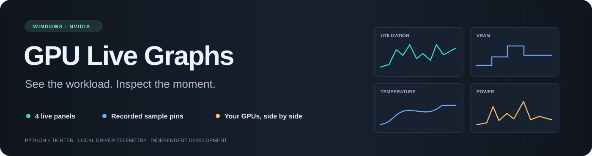
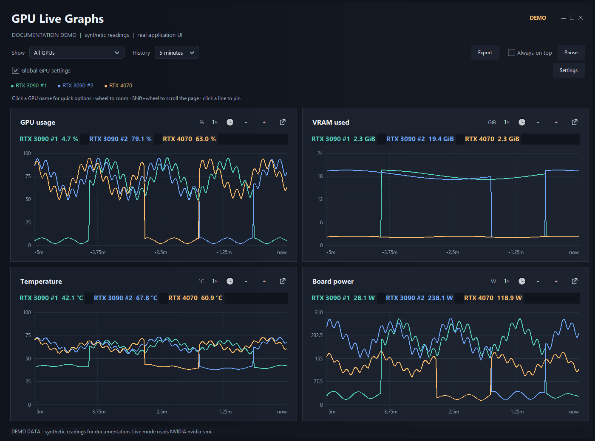
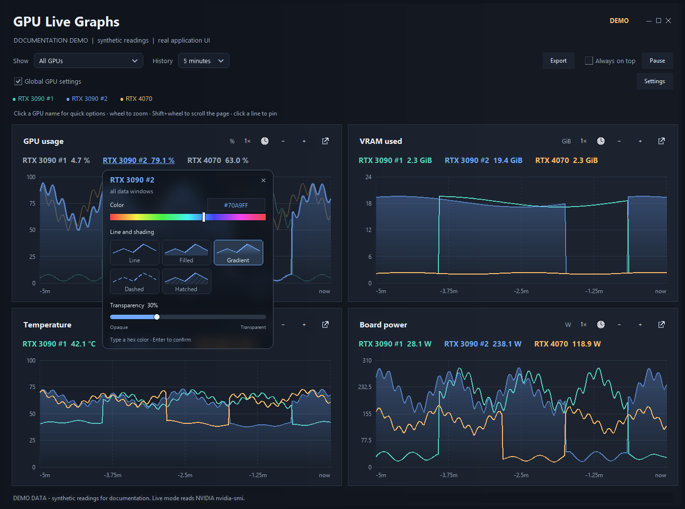
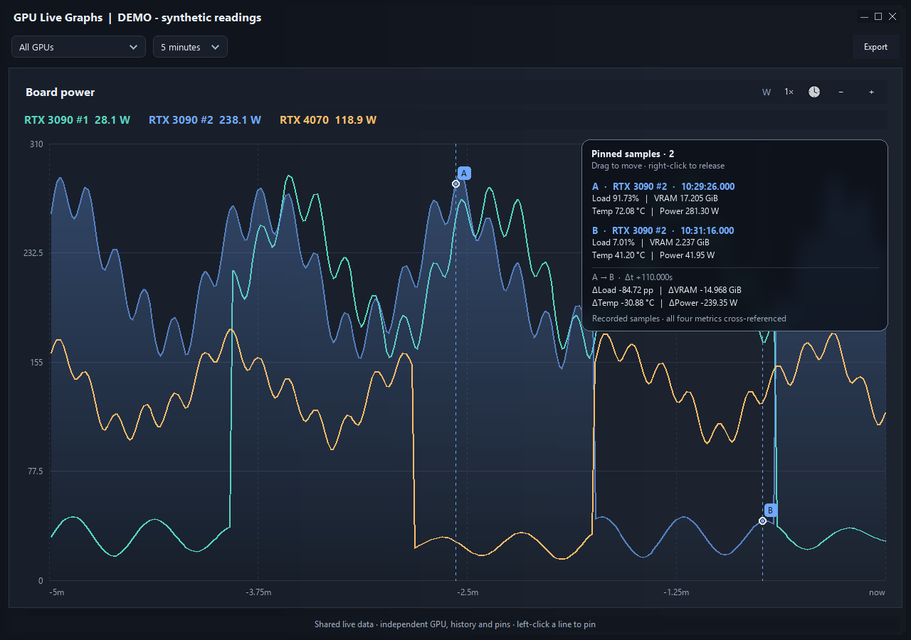
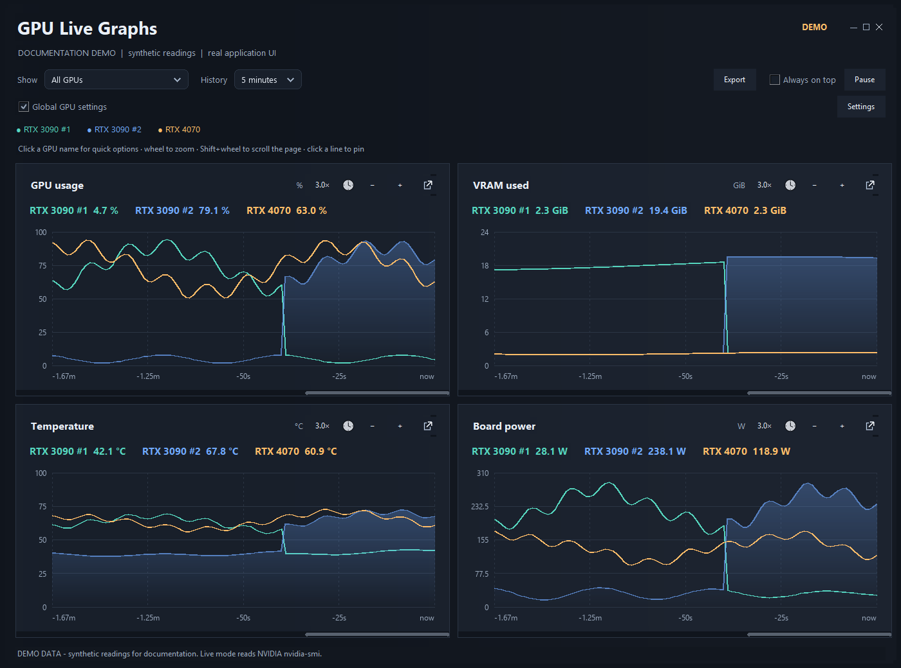
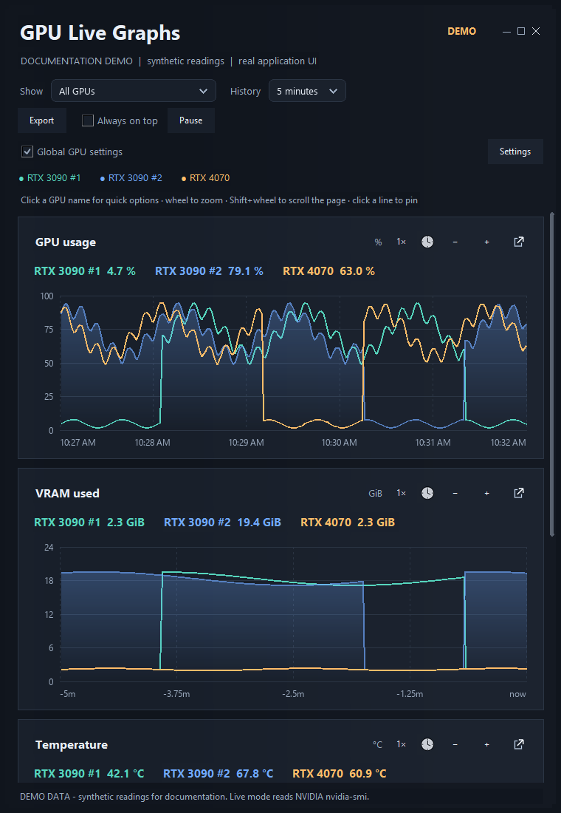
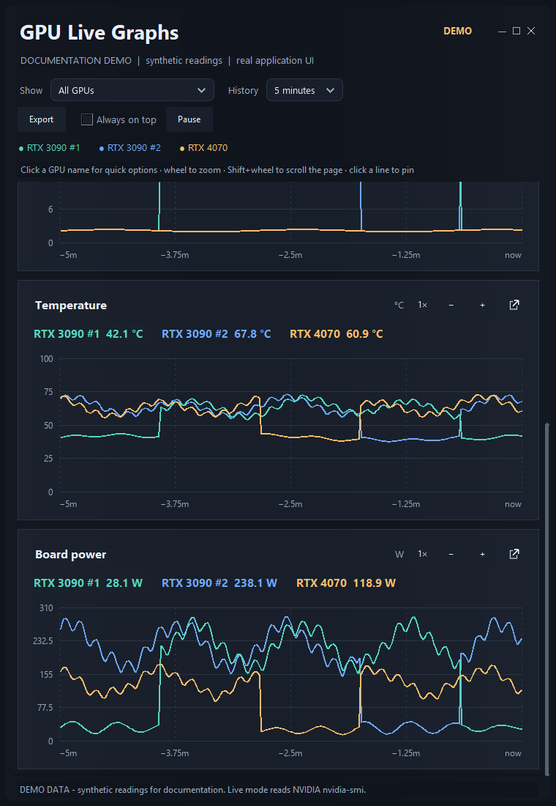

<div align="center">



**Four live graphs. Every NVIDIA card. The details behind each spike.**


[](https://github.com/walladanger/New-gpu-monitor-4way4the4play/actions/workflows/windows-checks.yml)

[Get started](#get-started) · [Feature tour](#feature-tour) · [User guide](docs/USER-GUIDE.md) · [Roadmap](ROADMAP.md)

</div>

GPU Live Graphs is a focused Windows desktop monitor for **GPU utilization, VRAM, core temperature, and board power**. Compare cards at a glance, zoom into a workload, and pin recorded samples to see how the measurements changed together.

Built in **Python**, with **Tkinter** desktop windows and **Pillow** graph rendering. Monitoring is read-only; the app does not change clocks, fans, or power limits.



> **Screenshot data:** These are captures of the real application populated with synthetic readings for a reproducible feature tour. They are not benchmarks or live measurements from a particular PC. Normal operation reads your NVIDIA driver through `nvidia-smi`.

## At a glance

| 🟩 See the system | 🟦 Inspect the moment | 🟧 Make it your own |
| --- | --- | --- |
| Four measurement panels | Pin several recorded samples | Per-panel GPU emphasis |
| One trace per detected GPU | Cross-reference all four metrics | Editable hex colors and hue slider |
| Clear names for duplicate cards | Compare changes and elapsed time | Five line and shading styles |
| Wide grid or vertical stack | Wheel zoom with timeline panning | Independent graph windows |
| Stale and driver-error status | CSV, PDF, and graph PNG exports | Frameless window and subtle light drift |

## Get started

**Requirements:** Windows 10/11, Python 3.11+ with Tkinter, Pillow 12.x, and an NVIDIA driver providing `nvidia-smi`. No CUDA Toolkit, API key, GPU Taskman installation, or cloud service is required.

1. [Download the source ZIP](https://github.com/walladanger/New-gpu-monitor-4way4the4play/archive/refs/heads/main.zip) and extract the entire folder, or clone this repository.
2. Install the dependency once:

   ```powershell
   python -m pip install -r requirements.txt
   ```

3. Double-click **[Start.cmd](Start.cmd)** to launch without a console window.

For console diagnostics, run `python gpu_live_graphs.py`. Close older running builds before switching versions. History is currently kept in memory and does not transfer between processes. A bundled EXE/installer is **planned**, not included in this source version.

## Feature tour

### 01 · Four panels, one workload

| Panel | Measurement | Unit |
| --- | --- | --- |
| GPU usage | Device utilization reported by the driver | % |
| VRAM used | Used device memory, converted from MiB | GiB |
| Temperature | GPU core temperature | °C |
| Board power | GPU board power, not total PC wall power | W |

Select one GPU or show all of them. Choose **1, 5, or 15 minutes** of history. One shared sampler supplies the main dashboard and all detached windows.

Names come from the driver. Identical cards receive labels such as **RTX 3090 #1** and **RTX 3090 #2**; UUIDs identify cards internally. The app is not hard-coded to three GPUs.

### 02 · Click a name. Follow that GPU.



Click a GPU name **inside a panel** to emphasize its trace and dim the others in that panel. Its frosted menu contains:

- **Color input:** type `#RRGGBB` or `#RGB`; valid complete colors preview immediately.
- **Hue slider:** change the color visually.
- **Five visual styles:** Line, Filled, Gradient, Dashed, and Hatched.

Click the same name again to restore equal emphasis. The top legend can focus one GPU across all four main panels. Exports stay in the toolbar, keeping this menu focused on appearance.

### 03 · Pin the moment. Compare the details.



**Left-click near a line** to pin the nearest actual recorded sample. A lettered marker identifies its timestamp. The inspector cross-references load, VRAM, temperature, and power from that same recorded query.

Add more pins to compare changes and elapsed time. **Right-click a marker or inspector row** to release that pin. Pins expire when they leave the selected base history range; pausing freezes the timeline. Zooming does not fabricate finer samples.

The inspector uses a dark translucent surface with a blur of the graph beneath it. Drag its header to move it, and scroll inside when its contents overflow.

### 04 · Zoom without losing the timeline



Use the **mouse wheel over a graph** for zoom centered around the pointer. Corner **+ / −** buttons provide incremental control; click the zoom multiplier to reset.

The slim horizontal scrollbar appears **only while zoomed**. Drag it to inspect earlier data within the selected history range. **Shift + wheel** scrolls the dashboard page. Values above a graph continue to show the latest sample while you inspect older graph data.

### 05 · Four panels, even when space gets narrow

<p align="center">


</p>

The wide layout is a **2 × 2 grid**. Below approximately 1,060 pixels of graph-area width, all four panels become a **single vertical stack**. A page scrollbar appears when needed; the other panels remain available below the fold.

Drag edges or corners to resize. Use the custom maximize button or double-click the heading to maximize/restore. Drag the heading to move the window. A subtle horizontal gradient drifts slowly through the app and respects Windows' client-area animation preference.

### 06 · Give a graph its own window

Click a panel's small **square-and-arrow icon**. A live copy opens separately while the original four panels stay in place.

The new window initially copies the view and pins, then keeps independent GPU selection, history range, focus, colors, styles, zoom, and pins. All windows share the sampler and pause state. Closing a detached window leaves the dashboard running.

### 07 · Take the evidence with you

| Export | Where | Result |
| --- | --- | --- |
| CSV | Toolbar → Export → panel and GPU | Recorded rows in the visible range, timestamps, identity, and all four metrics |
| PDF | Same Export menu | Graph, summary, and sample tables |
| PNG | Export → Save all graphs as PNG | Four graphs with visible values and pin details, ready for annotations |

CSV/PDF files go into `exports/`; graph images go into `captures/` beside the app. Unsupported values stay missing rather than becoming false zeroes. Detached windows can export their own graph.

## Where the data comes from

**NVIDIA driver → `nvidia-smi` → shared background sampler → in-memory history → main/detached graphs and exports.**

Normal operation polls roughly once per second. Sensor precision and availability depend on the driver and GPU. Timestamps describe the completed query; they do not guarantee every sensor sampled simultaneously.

This is an **independent project inspired by [Scott Hanselman's GPU Taskman](https://github.com/shanselman/gputaskman)**. It does not include GPU Taskman's code, read its output, or offer its process/model/KV-cache inspector. It is separate from the older `walladanger/GPU-Monitoring` application.

## What is still left?

1. **Stability qualification:** long workload runs, mixed-DPI displays, and investigation of remaining abrupt exits.
2. **Saved preferences:** positions, GPU colors, styles, filters, and history range.
3. **Persistent history:** survive restarts with retention and disk limits.
4. **Easy installation:** bundled EXE, installer, checksums, and release validation.
5. **Tray and alerts:** quick view and configurable thresholds.
6. **Process/runtime insights:** GPU processes first; active requests, tokens/sec, and TTFT through separate runtime adapters later.

The [prioritized roadmap](ROADMAP.md) has status, scope, and acceptance criteria. Unchecked items are planned features, not capabilities implied by the screenshots.

## Troubleshooting

- **No readings?** Run `nvidia-smi` and verify that the NVIDIA driver sees the cards.
- **No window?** Run `python gpu_live_graphs.py` for startup errors.
- **Unexpected exit?** Keep `logs/app.log` and `logs/native-crash-PID.log`. Review logs before sharing; they may include local paths and driver diagnostics.
- **Old appearance after updating?** Close the older process and launch the new folder's `Start.cmd`.

Version 0.4.1 repaired the frameless resize regression, removed the Python native-window callback, and added redraw recovery and local logs. The reported abrupt exit was not reproduced in the earlier 100-cycle stress run; it is not considered conclusively resolved.

## Development

```powershell
python -m unittest discover -s tests -v
python tools/capture_screenshots.py
python tools/check_docs.py
```

The screenshot tool opens **its own demo instance**, queries no GPU, and captures only that instance's windows. Windows-specific checks require a Windows desktop session. The [Windows workflow](https://github.com/walladanger/New-gpu-monitor-4way4the4play/actions/workflows/windows-checks.yml) runs checks on Python 3.11 and 3.14 and attaches a source ZIP plus SHA-256 checksum to successful runs; this is a source package, not a bundled executable.

[User guide](docs/USER-GUIDE.md) · [Screenshot walkthrough](docs/FEATURE-TOUR.md) · [Design findings](docs/DESIGN-REVIEW.md) · [Contributing](CONTRIBUTING.md) · [License](LICENSE)
