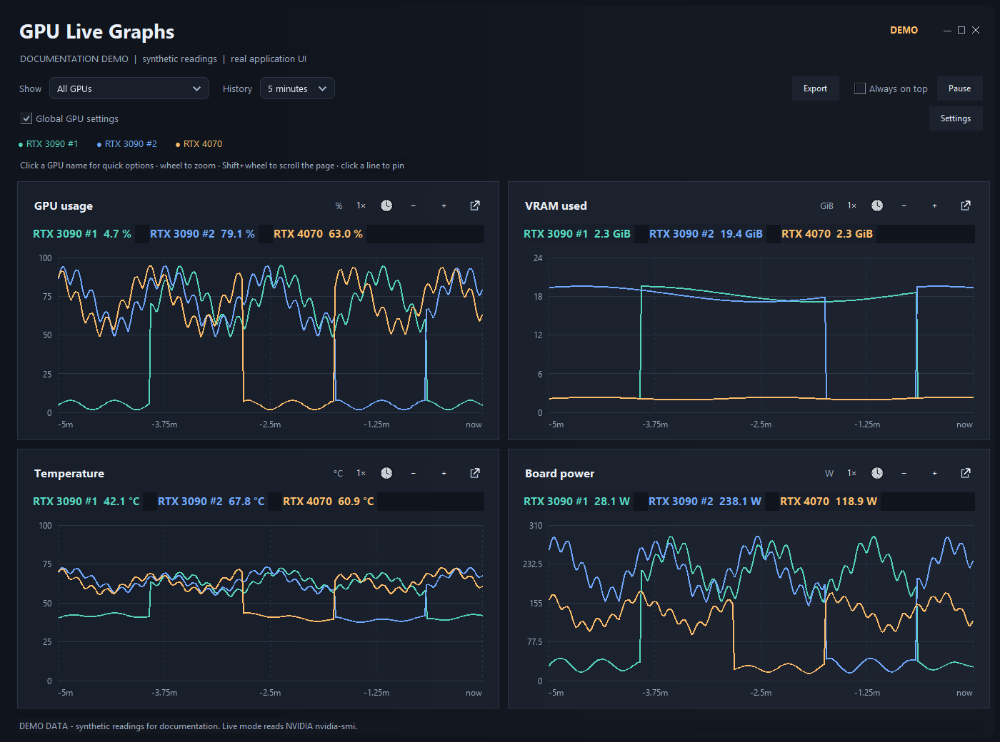
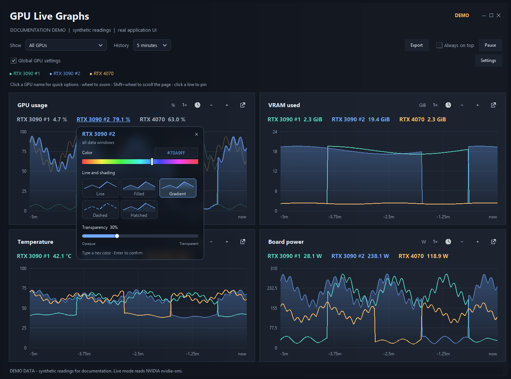
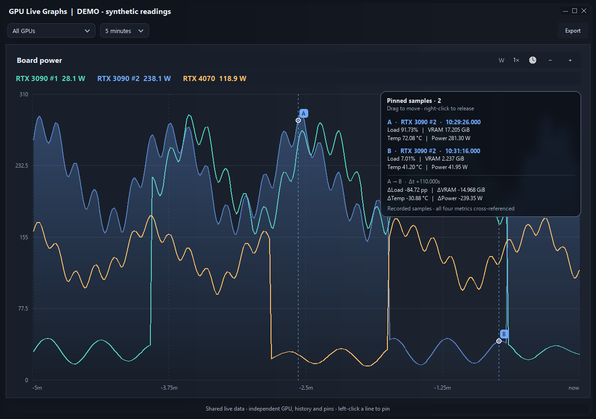
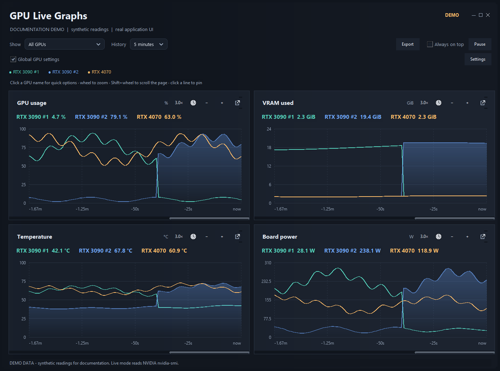
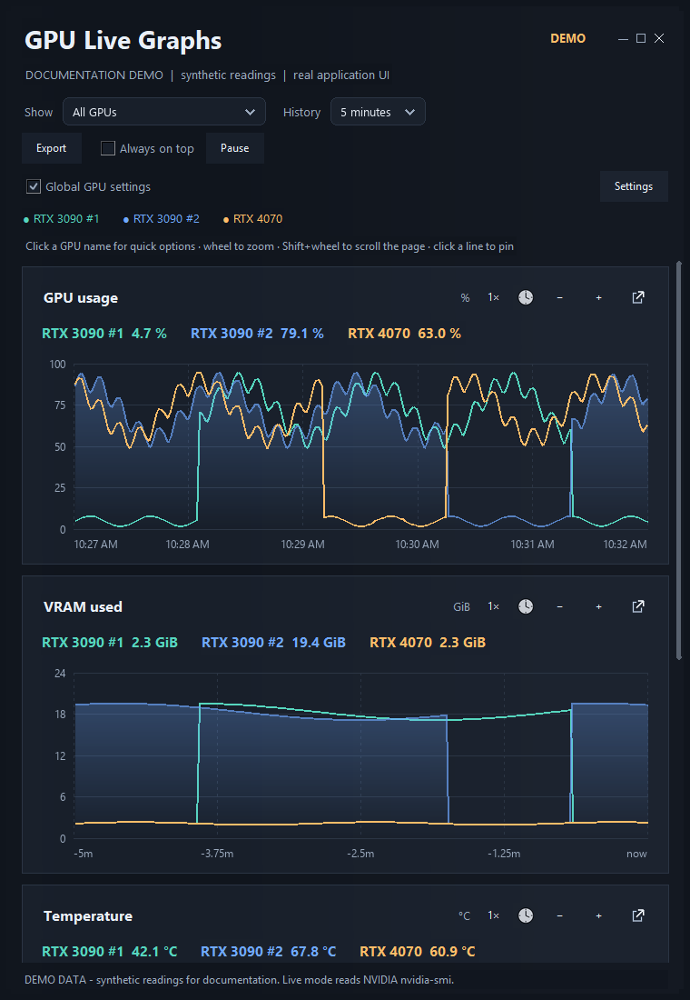
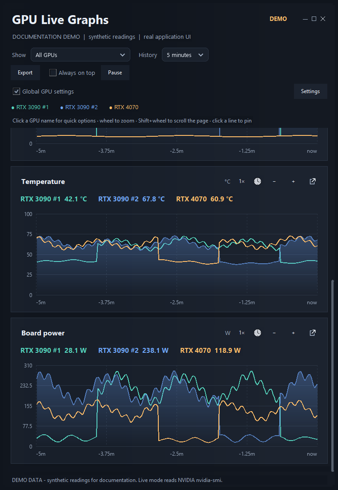
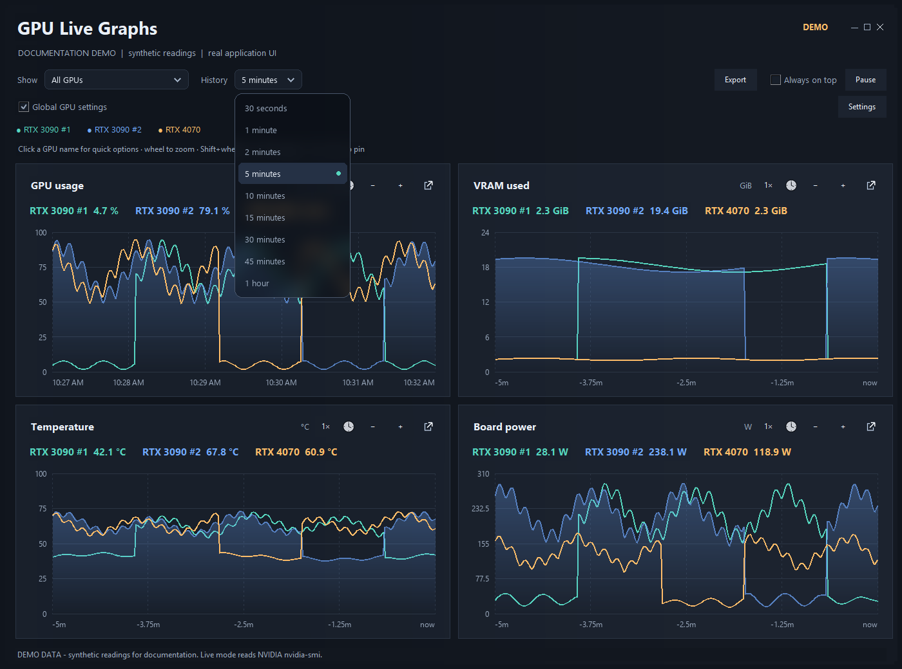
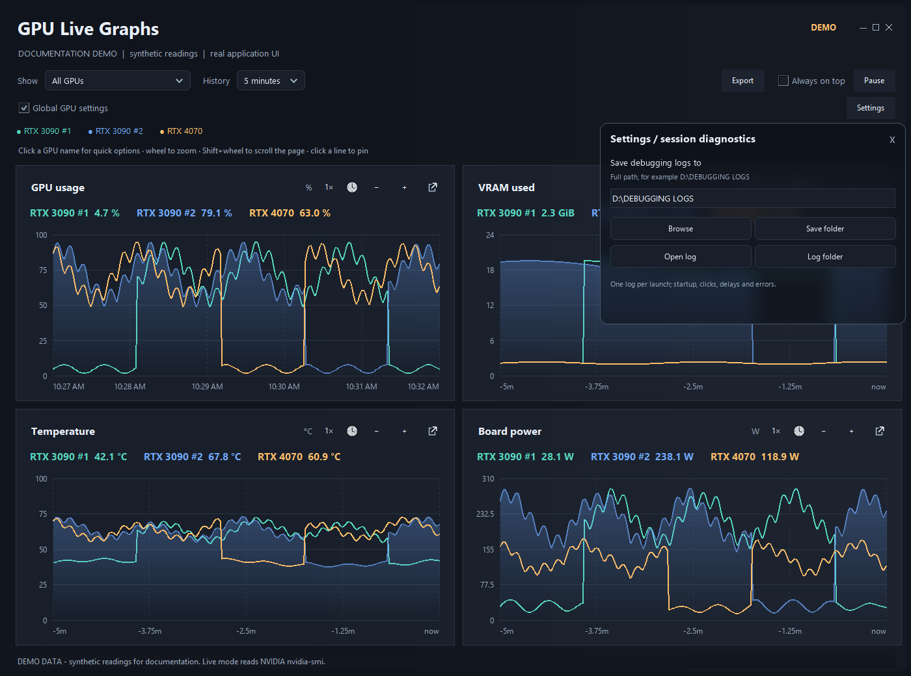

# A guided look at GPU Live Graphs

These eight screenshots are captures of the **actual 0.6.0 application** with synthetic readings. The documentation tool queries no NVIDIA devices. All illustrated controls are implemented; the waveforms are demonstration data, not performance results.

## 1. Dashboard overview



**Look for:** the four measurement titles, units, named GPU buttons, Show/History selectors, and one consistent color per GPU. The small square-and-arrow at each panel's top-right opens a separate graph window.

**Try it:** leave Show on All GPUs, select 5 minutes, then pause a workload to inspect its history. Normal live sampling comes directly from `nvidia-smi`.

## 2. Per-GPU focus and appearance



**Look for:** the bright blue selected trace, dimmed alternatives, hex color input, hue slider, five preview tiles, and transparency slider. Global GPU settings is checked by default, applying appearance across all data windows. Uncheck it for local edits. Export deliberately stays in the toolbar.

**Try it:** click a GPU name, enter `#70A9FF`, choose Gradient, then click the name again to restore equal emphasis.

## 3. Separate window and pinned comparisons



**Look for:** A/B markers, precise recorded values, timestamps, elapsed time, and changes across all four metrics. This graph is in its own frameless window.

**Try it:** open a graph using its icon, left-click two points near a line, then right-click one marker or inspector row to remove it. Drag the inspector header if it obscures a useful part of the graph. The measurement precision comes from the recorded query, not screen coordinates.

## 4. Zoom and time navigation



**Look for:** the 3.0× reset controls, shorter displayed time span, and thin horizontal bars. The bars are absent in the unzoomed overview.

**Try it:** wheel over a graph, pan with its scrollbar, and click the multiplier to reset. Shift+wheel scrolls the page. Each graph can keep its own view.

## 5. Narrow layout, upper panels



**Look for:** full-width panels stacked vertically and a page scrollbar. The toolbar also wraps to keep its controls usable.

**Try it:** drag the main window's side inward. The four panels remain in the dashboard; the lower ones move below the fold.

## 6. Narrow layout, lower panels



**Look for:** the temperature and board-power panels, with the scrollbar thumb farther down. This is the same window and data as step 5.

**Try it:** Shift+wheel over a graph or drag the page scrollbar to reach the lower panels.

## 7. Clock time and expanded history



**Look for:** the circled clock in each header and the 10:27 AM to 10:32 AM scale on GPU usage. Other graphs retain relative labels. The frosted History menu offers nine ranges from 30 seconds to one hour.

**Try it:** press a graph's clock, zoom, and pan. The time mode follows that window without resetting the view.

## 8. Session diagnostics



**Look for:** the full folder input, Browse, Save folder, Open log, and Log folder controls. The displayed D: path is a documentation example; the screenshot tool does not save that setting.

**Try it:** open Settings and choose a writable location. Each session gets uniquely named startup, interaction, error and native-fault logs.

## Exports and source

The toolbar Export menu offers selected-GPU CSV/PDF and graph PNG output. CSV/PDF use the selected series' visible time range. PNG includes visible pin details and is useful for feedback annotations.

See [the full user guide](USER-GUIDE.md), [current design findings](DESIGN-REVIEW.md), or [the development roadmap](../ROADMAP.md).

## Reproduce these captures

On Windows, from the repository root:

```powershell
python -m pip install -r requirements.txt
python tools/capture_screenshots.py
```

The tool opens and closes its own demo instance and uses Windows PrintWindow for that instance's window handles only. It does not take a desktop-wide screenshot, capture other applications, or alter the live monitor's data. Inspect the generated PNGs before publishing updated captures.
