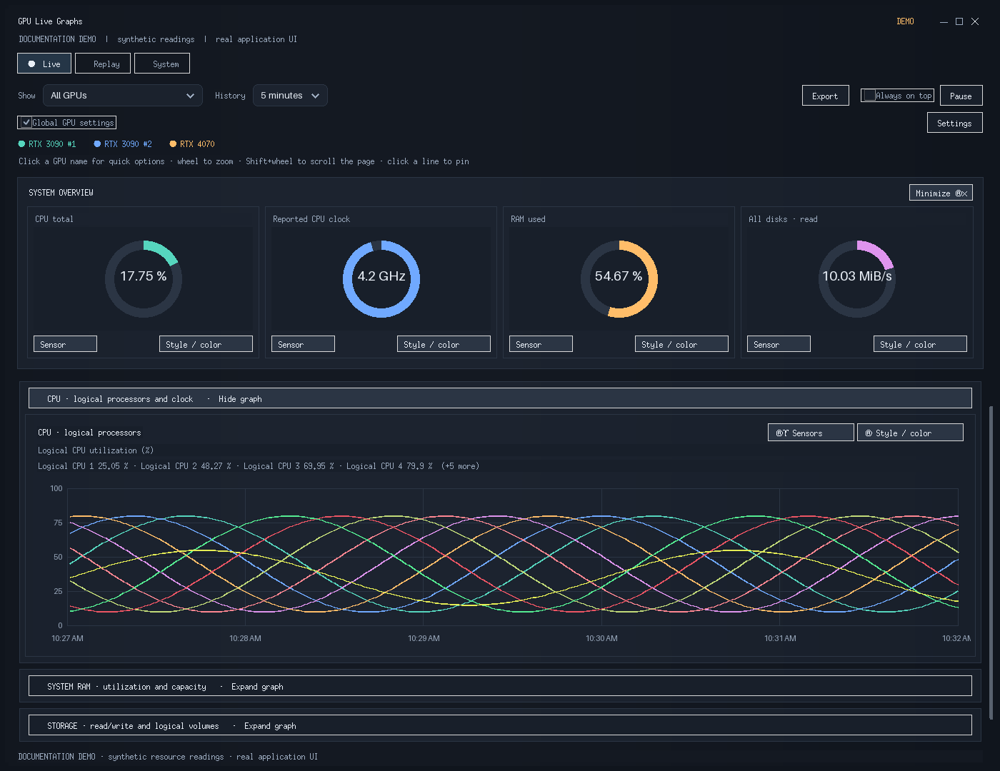
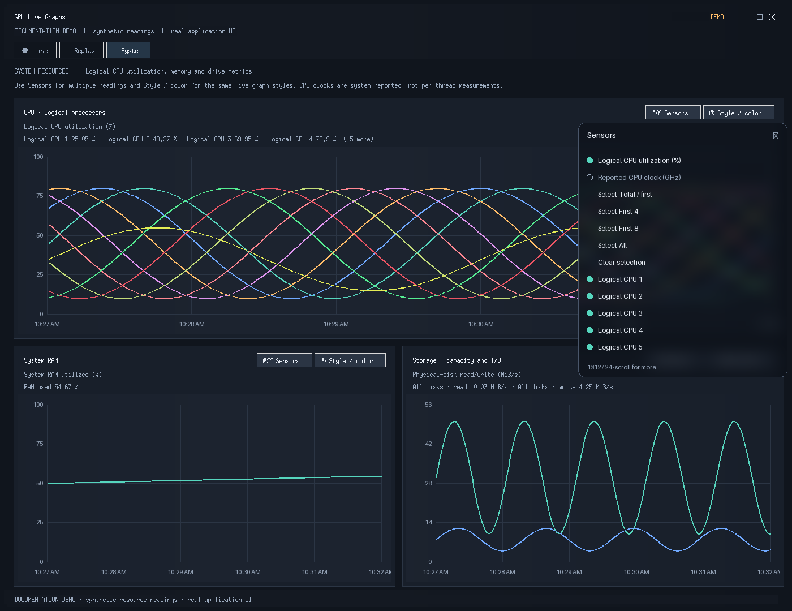
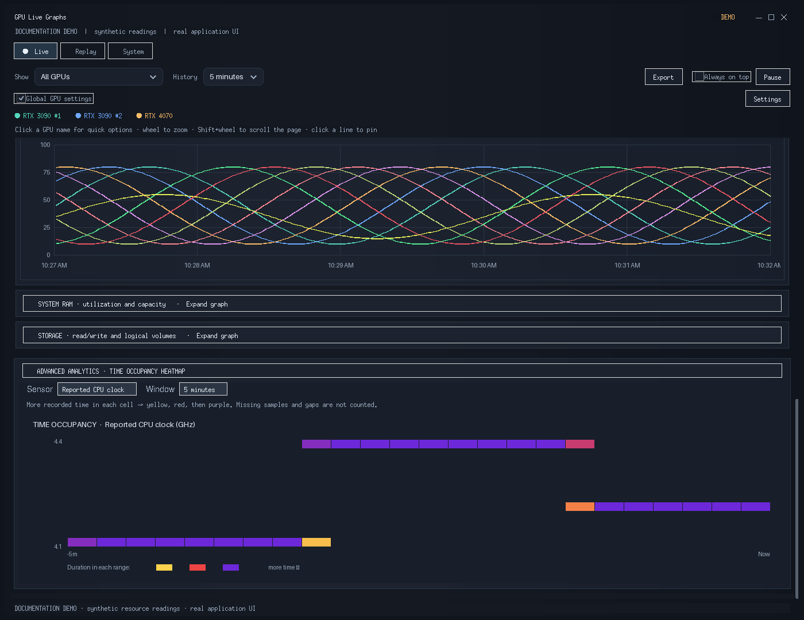

# CPU, RAM and storage views

Version 0.8.0 adds resource views beneath the four original GPU graphs and in a separate **System** tab. GPU layouts, controls, NVIDIA collection, history and Replay remain available.

## The compact rack

Scroll below the GPU graphs to see four circular gauges. Their initial sensors are CPU utilization, reported CPU GHz, RAM utilization and combined disk read rate. **Sensor** chooses another available reading. **Style / color** offers Ring, Pie or Arc, palette colors, and an editable hex field with a hue slider.

**Minimize** hides the rings and controls while retaining numerical readings. Expand them to edit again. CPU, RAM and storage each have an independent expandable detail panel underneath.

Percentage gauges use a 0–100 range. RAM/volume capacity gauges use reported totals. Clock and I/O gauges scale to recent observed values; the full ring does not mean an advertised hardware maximum has been reached.

## Details and sensor selection

Use **System** for a full-width CPU graph and RAM/storage panels. **Sensors** switches between utilization/clock, RAM percentage/capacity, and disk throughput/volume capacity. Select a preset or toggle individual sensors; scroll long lists for additional logical CPUs and drives. Selected sensors stay distinct. Switching away from a CPU mode and back retains its explicit selection.

**Style / color** offers the same five line/fill styles used by the GPU charts. The color submenu edits a particular sensor. These new menus use the shared dark, 50% tinted, locally blurred surface.

## Occupancy heatmap

Expand **Advanced analytics · time occupancy heatmap** at the bottom of Live. Choose a sensor and one minute, five minutes, fifteen minutes or one hour. Time runs left to right; the sensor's value ranges run bottom to top. GHz uses the visible observed range to show small frequency differences.

The color represents how much recorded time was spent in a cell: yellow, then red, then purple. A high instantaneous value does not automatically turn a cell purple. A sample interval contributes only when the next sample is within 2.5 seconds; gaps and missing readings are excluded. The final sample has no invented future duration.

The grid adapts to the available space, up to 100 time columns and 48 value bands. The legend shows the active resolution. GPU panels offer their own heatmap view from the graph-type menu, with one lane per GPU and hover details.

## What the readings mean

| Reading | Meaning |
| --- | --- |
| Logical CPU 1, 2, etc. | Utilization of an OS logical processor; not a process's software thread |
| Reported CPU clock | System-reported GHz; per-logical-processor GHz is not exposed as a reliable Windows measurement |
| RAM | Whole-system used/available/cached/total GiB or percentage; unavailable counters stay unavailable |
| All disks / physical drive I/O | Differences in read/write byte counters divided by that counter's elapsed time, in MiB/s |
| Volume capacity | Filesystem volume used/free/total GiB; never silently mapped to a physical disk |

The sampler is read-only and runs on its own worker. The first CPU-percent interval is primed rather than presented as a measurement. If a counter resets or time does not advance, its transfer rate is unavailable rather than a negative value. A returning drive uses its actual interval, preventing a reconnect spike caused by dividing several seconds of traffic by one second.

Pause from Live freezes both kinds of live graphs. Resume continues with a gap. Collection runs independently of Replay. Gauge layout and system appearance settings are saved; missing sensors retain their identity and display unavailable values.

## Current limits

System history is in memory only, up to 4,000 snapshots. GPU history alone is archived to SQLite and available in Replay and existing CSV/PDF exports. System detail graphs currently show five minutes and do not yet have GPU pinning, zoom or export controls. Tray, alerts and process/runtime insights remain deferred.

The three screenshots above are actual Tk test-app captures on an isolated Linux display, using explicitly labeled synthetic data. They demonstrate implemented controls, not Windows hardware readings or benchmark results. The original screenshots elsewhere in the guide were captured on Windows. Reproduce resource captures with `python tools/capture_resources.py`; on Windows the tool uses the existing window-only capture path.
